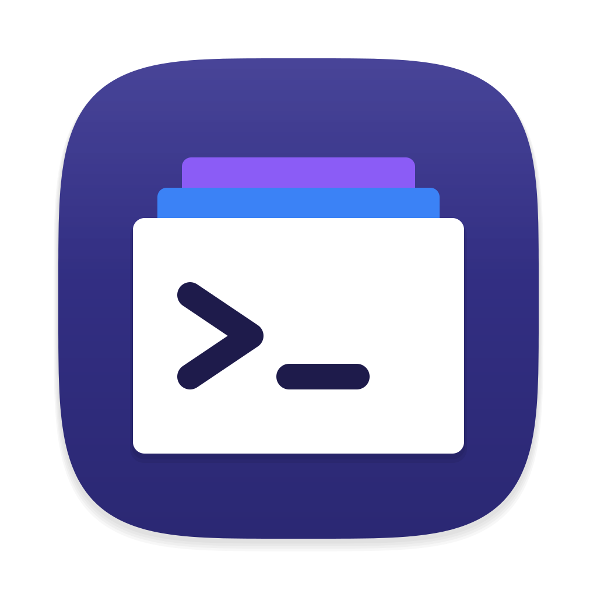
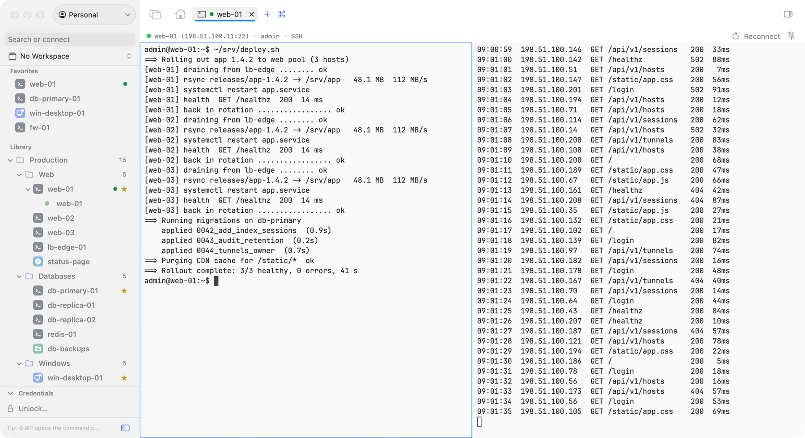
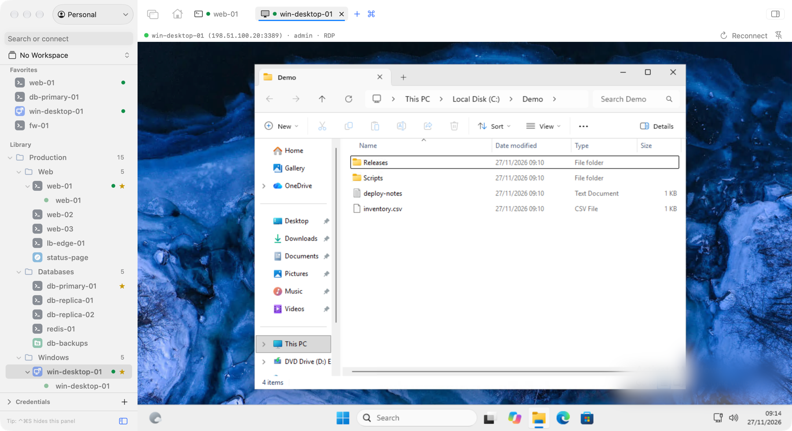

<div align="center">



# Gantry Terminal

**Remote administration for sysadmins. SSH, RDP, VNC, files and credentials in one native app.**

[](LICENSE)
[](https://github.com/SealedDream/gantry/releases/latest)
[](#download)
[](#download)

<a href="https://github.com/SealedDream/gantry/releases/latest/download/Gantry-macos-arm64.dmg"></a>
&nbsp;
<a href="https://github.com/SealedDream/gantry/releases/latest"></a>

<br><br>

https://github.com/user-attachments/assets/1ecabefe-6c6a-4b16-955f-cd11b079e466


<sub><a href="docs/media/video/gantry-launch.mp4">Launch film (68 s)</a> · <a href="docs/media/gallery/README.md">Screenshots</a></sub>

</div>

## Features

<table>
<tr>
<td width="33%"><b>One library</b><br>Folders, tags and search for every server. Settings inherit down the tree.</td>
<td width="33%"><b>SSH that stays up</b><br>Strict host keys, jump hosts, split panes, tmux and Mosh.</td>
<td width="33%"><b>RDP and VNC in tabs</b><br>Clipboard, sound and shared folders next to your terminals.</td>
</tr>
<tr>
<td><b>Files</b><br>SFTP browser with a transfer queue. SCP and FTPS too.</td>
<td><b>Tunnels</b><br>Saved local, remote and SOCKS forwards, started on demand.</td>
<td><b>Encrypted vault</b><br>Argon2id and XChaCha20. Touch ID or Windows Hello.</td>
</tr>
<tr>
<td><b>Tasks</b><br>One command on up to 16 hosts, with a check before production.</td>
<td><b>Plugins</b><br>Docker, Kubernetes, Proxmox VE, VMware ESXi, PostgreSQL. Signed and sandboxed.</td>
<td><b>Web and palette</b><br>Admin pages in tabs. Every command and host from ⇧⌘P.</td>
</tr>
</table>

No account, no telemetry, works fully offline. Imports OpenSSH config, PuTTY, `.rdp`, RDCMan, mRemoteNG and CSV.

## Screenshots

<p align="center">
  <picture>
    
  </picture>
  <br><b>SSH</b> · Split panes: a rollout on the left, live traffic on the right.
</p>

<p align="center">
  <picture>
    
  </picture>
  <br><b>Remote Desktop</b> · A live Windows desktop in a tab.
</p>

<p align="center"><a href="docs/media/gallery/README.md"><b>More screenshots →</b></a><br><sub>Library, SFTP, tunnels, Proxmox, Kubernetes, plugins, command palette, Windows 11</sub></p>

## Download

| | File | Needs |
|---|---|---|
| **Mac** | `Gantry-macos-arm64.dmg` or `.zip` | macOS 14+, Apple silicon |
| **Windows** | `Gantry-<version>-windows-x64-setup.exe` or `Gantry-windows-x64.zip` | Windows 10 or 11, x64 |

Windows from PowerShell (per user, no admin):

```powershell
irm https://github.com/SealedDream/gantry/releases/latest/download/install.ps1 | iex
```

Each download includes the signed Official plugins in `plugins/`: open **Settings › Plugins › Install from File…** to add them. Every release has a `SHA256SUMS` file.

<details>
<summary><b>First launch (unsigned builds)</b></summary>

Gantry is not signed with a paid certificate, so your system warns you once.

- **Mac:** drag Gantry to Applications, then right-click it › **Open** › **Open**. If you only see **Done**, go to **System Settings › Privacy & Security** and click **Open Anyway**.
- **Windows:** run the setup (or `Gantry.exe` from the zip). At "Windows protected your PC", click **More info › Run anyway**.

Windows setup options: a version or all users with `& ([scriptblock]::Create((irm <install.ps1 url>))) -Version 1.0.0 -AllUsers`; silent with `setup.exe /VERYSILENT /CURRENTUSER`. Uninstall from **Settings › Apps › Gantry Terminal**; your library in `%APPDATA%\Gantry` stays unless you tick remove.

Check the download first: `shasum -a 256 -c SHA256SUMS --ignore-missing` (Windows: `Get-FileHash`).
</details>

<details>
<summary><b>Build from source</b></summary>

Each crate (`core`, `core-ffi`, `core-cabi`, `rdp-ffi`) has its own `Cargo.toml`; there is no root workspace.

```bash
cd core && cargo test
```

```bash
cd apps/macos && ./build-core.sh && ./build-rdp.sh && swift build -c release && ./bundle.sh
```

Windows, in `apps\windows`: `build-core.ps1`, `dotnet build -c Release -p:Platform=x64`, `package-windows.ps1 -NoInstaller`. Release archives: [`scripts/package-release.sh`](scripts/package-release.sh). Tests: [docs/TESTING.md](docs/TESTING.md). Design: [ARCHITECTURE.md](ARCHITECTURE.md).
</details>

<details>
<summary><b>Security</b></summary>

Offline by default. A changed SSH host key is always refused. Secrets stay in the encrypted vault, never in documents, backups or logs. Plugins run in a sandbox, see only the host they were opened on, and never see your password. Telnet and plain FTP are off until you accept the risk.

Details: [SECURITY.md](SECURITY.md) and [THREAT_MODEL.md](THREAT_MODEL.md). Report a vulnerability privately: **Security › Report a vulnerability**.
</details>

<details>
<summary><b>Contributing</b></summary>

Open an issue before a large change. Keep pull requests small, run the tests for what you touched, and write commit messages like `fix: short description`. The cross-platform front end in `ui-tauri/` is not shipped.
</details>

## License

[Apache-2.0](LICENSE). Third-party notices are in [licenses/](licenses/).
