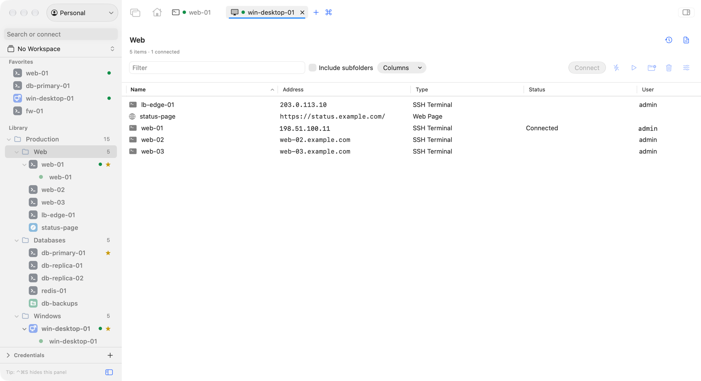
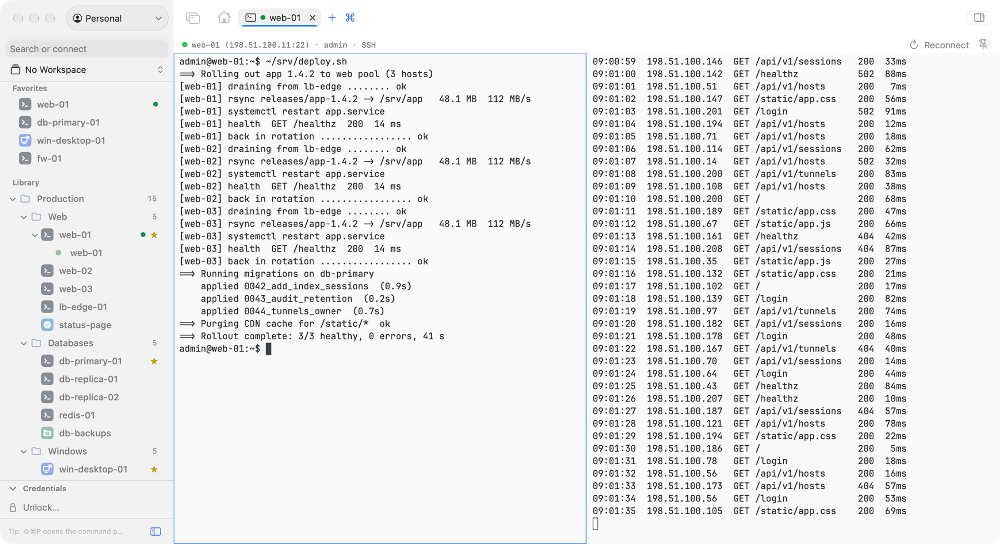
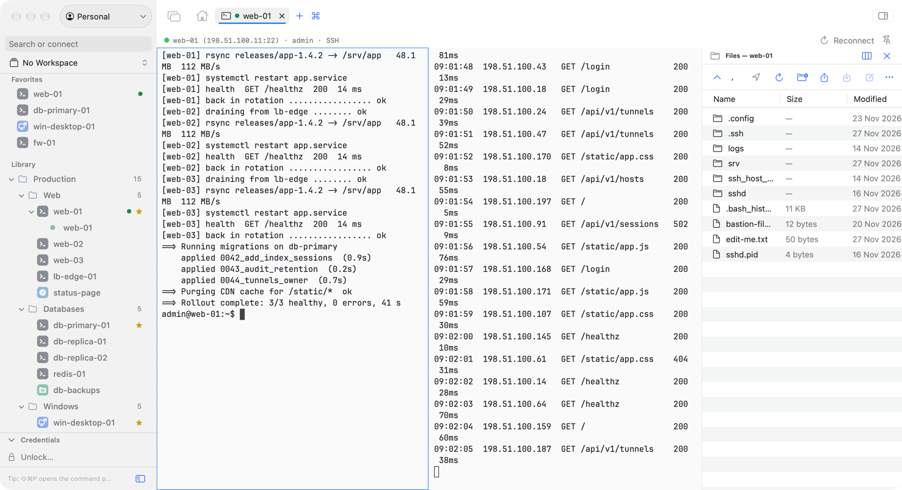
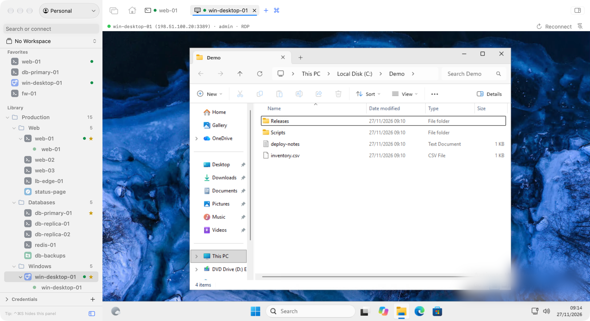
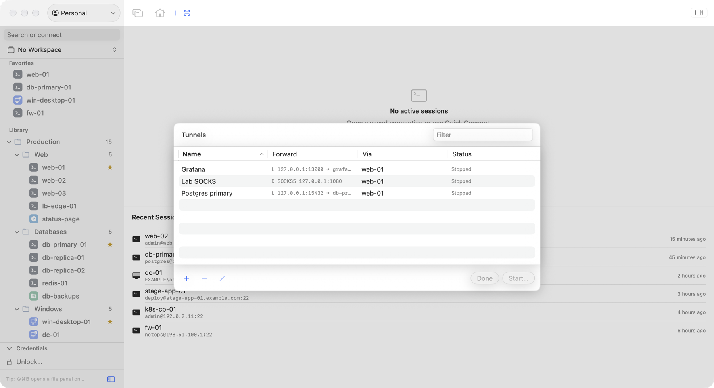
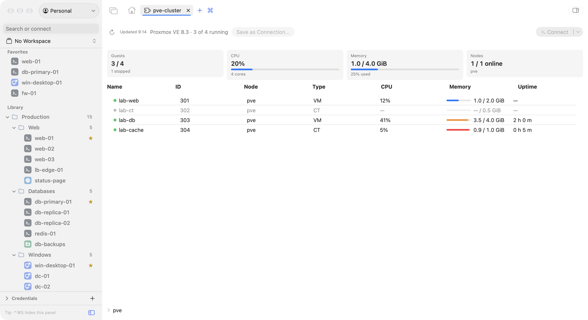
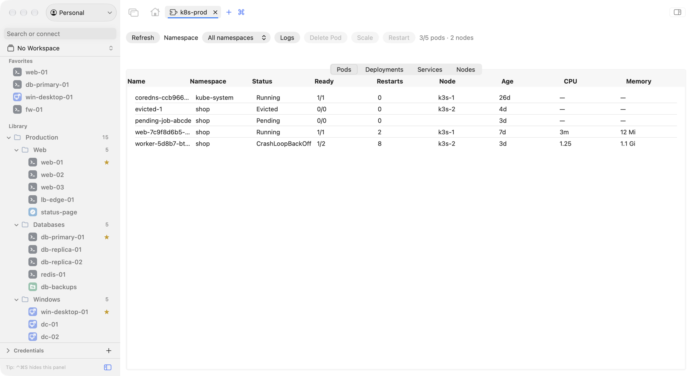
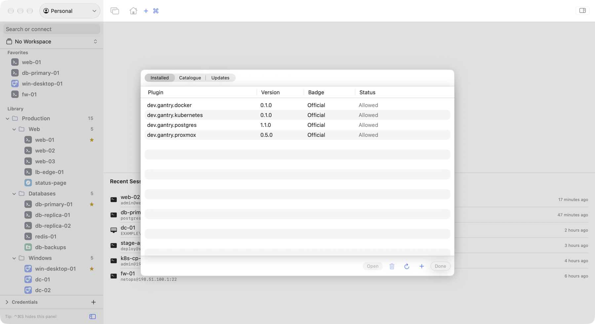
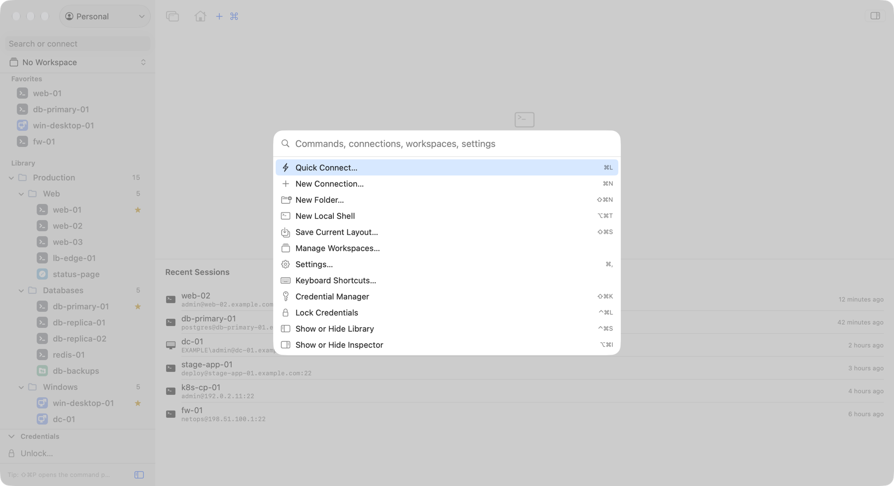
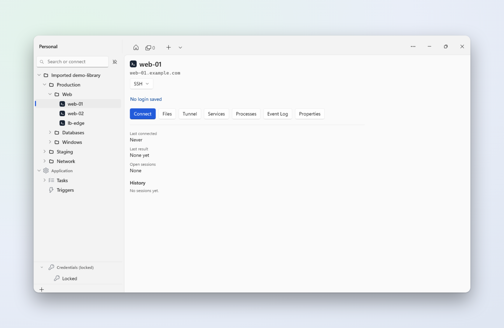

# Screenshots

Native Mac unless noted. All names and addresses are demo data.

[← Back to the README](../../../README.md) · Video: [launch film (68 s)](../video/gantry-launch.mp4)

## Library

  <picture>
    
  </picture>
   Folders, favourites and inherited settings. A folder lists its hosts and who is connected.

## SSH

  <picture>
    
  </picture>
   Tabs and split panes. Strict host keys, jump hosts, Mosh and tmux.

## SFTP

  <picture>
    
  </picture>
   Browse and transfer files on the same login.

## Remote Desktop

  <picture>
    
  </picture>
   Windows desktops in a tab, with clipboard, sound and shared folders.

## Tunnels

  <picture>
    
  </picture>
   Saved local, remote and SOCKS forwards, started on demand.

## Proxmox VE plugin

  <picture>
    
  </picture>
   Guests, CPU and memory for a node or cluster.

## Kubernetes plugin

  <picture>
    
  </picture>
   Pods, deployments, services and nodes. Changes stay off until you allow them.

## Plugins

  <picture>
    
  </picture>
   Official plugins are signed and run in a sandbox.

## Command palette

  <picture>
    
  </picture>
   ⇧⌘P reaches every command, connection and setting.

## Windows 11

  <picture>
    
  </picture>
   The same library in the native Windows app.

